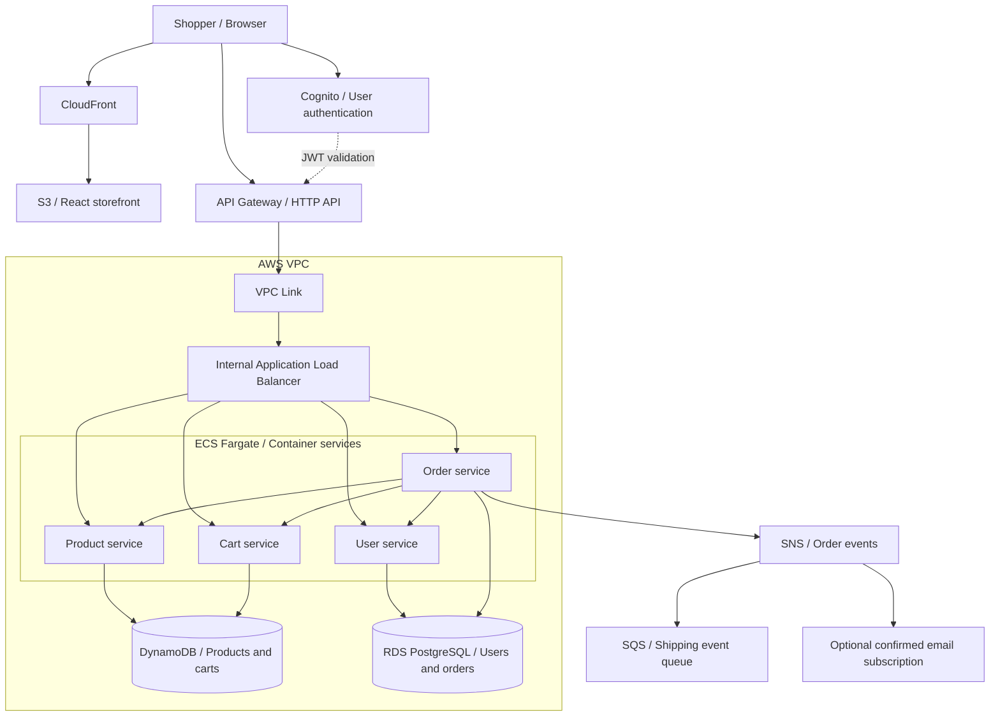

<div align="center">

# ☁️ CloudCart

### A cloud-native shopping experience, from storefront to infrastructure.

**Maintained by [Kartik Gonde](https://github.com/KartikGonde)**


[Features](#features) · [Architecture](#architecture) · [Getting started](#getting-started) · [Deployment](#automated-deployment) · [Maintainer](#maintainer-and-acknowledgments)

</div>

---

CloudCart is an e-commerce learning and portfolio project that connects a React storefront to four Python microservices on AWS. It brings product browsing, shopping carts, user profiles, and order processing together with container deployment, managed databases, and event-driven notifications.

This repository is maintained by **Kartik Gonde**. It includes both a Terraform deployment workflow and step-by-step AWS deployment guides.

## Features

| Capability | What the project includes |
| --- | --- |
| Product catalog | Product images, descriptions, prices, and stock information backed by DynamoDB |
| Shopping cart | Add and remove products, track quantities, and calculate totals |
| Accounts | Amazon Cognito sign-up/sign-in and a user profile service backed by PostgreSQL |
| Orders | Create orders from a cart and review order history |
| Order events | Publish to SNS, deliver events to an SQS queue, and optionally subscribe an email address |
| Cloud deployment | Build container images, provision infrastructure, and publish the frontend through `deploy.sh` |

The repository contains **four backend services**. Notifications use SNS and SQS infrastructure; a separate notification worker and payment gateway are not included.

## Architecture



The Terraform API exposes `GET /products` publicly and uses a Cognito JWT authorizer for other application routes. Requests enter the VPC through a VPC Link and are routed to the services by an internal load balancer. CORS preflight requests have a separate route.

ECR stores container images, Parameter Store supplies service configuration, and CloudWatch collects container logs. The deployment guides also cover optional Route 53 and ACM configuration for a custom domain.

## Technology stack

| Layer | Technologies |
| --- | --- |
| Frontend | React, React Router, AWS Amplify UI |
| Backend | Python, FastAPI, Uvicorn |
| Authentication | Amazon Cognito |
| Compute | Docker, Amazon ECR, Amazon ECS Fargate |
| API and networking | API Gateway, VPC Link, ALB, VPC, subnets, security groups, NAT Gateway |
| Data | Amazon DynamoDB and Amazon RDS PostgreSQL |
| Hosting | Amazon S3 and CloudFront |
| Events | Amazon SNS and SQS |
| Configuration and logs | Systems Manager Parameter Store and CloudWatch |
| Infrastructure | Terraform and Bash deployment scripts |

## Repository structure

```text
CloudCart/
├── frontend/react-app/          # React storefront and Cognito integration
├── services/
│   ├── product-service/         # Product catalog and inventory
│   ├── cart-service/            # Shopping cart operations
│   ├── user-service/            # User profiles
│   └── order-service/           # Orders and event publishing
├── infra/                      # Terraform infrastructure definitions
├── data/                       # Sample catalog, product images, loading scripts
├── deployment/                 # Step-by-step AWS deployment modules
├── .github/workflows/          # Manually triggered prerequisite installer checks
├── docs/COMMIT_MESSAGES.md      # Ten planned commit messages
├── scripts/publish-cloudcart.py # GitHub publishing helper
├── install-prerequisites.sh    # Development tool installation helper
├── deploy.sh                   # Provision, build, and deploy
└── destroy.sh                  # Remove Terraform-managed resources
```

## Getting started

### Prerequisites

- Git, Node.js 20 or newer, and npm.
- Docker, running locally, for container builds.
- Terraform 1.5 or newer and an authenticated AWS CLI for cloud deployment.
- An AWS account with permissions to provision the services defined in `infra/`.

### Clone the repository

```bash
git clone https://github.com/KartikGonde/CloudCart.git
cd CloudCart
```

### Run the frontend locally

```bash
cd frontend/react-app
npm install
npm start
```

The development server runs at `http://localhost:3000`. The frontend requires a configured backend and Cognito user pool; this project does not include a standalone offline shopping mode.

Set the real values in [`frontend/react-app/src/aws-config.js`](frontend/react-app/src/aws-config.js):

```javascript
const awsConfig = {
  Auth: {
    Cognito: {
      userPoolId: 'YOUR_USER_POOL_ID',
      userPoolClientId: 'YOUR_USER_POOL_CLIENT_ID',
      loginWith: { email: true },
    },
  },
  API: {
    baseUrl: 'YOUR_API_GATEWAY_URL',
  },
};

export default awsConfig;
```

Replace every placeholder before signing in or calling the API. The current API client gives `awsConfig.API.baseUrl` priority over `REACT_APP_API_URL`, so setting the environment variable alone does not override a nonempty placeholder.

For a local frontend calling the Terraform-deployed API, add `http://localhost:3000` to `additional_cors_origins` in `infra/terraform.tfvars` and apply the infrastructure change. The automated deployment writes `aws-config.js` from Terraform outputs.

Build the frontend from `frontend/react-app` with:

```bash
npm run build
```

The generated files are written to `frontend/react-app/build/`.

## Automated deployment

Run from the repository root:

```bash
# Verify that the AWS CLI is using your intended account.
aws sts get-caller-identity

# Provision the infrastructure and deploy the application.
./deploy.sh
```

To add an order-notification email subscription on the first run:

```bash
NOTIFICATION_EMAIL=you@example.com ./deploy.sh
```

The script performs the following steps:

1. Checks the required tools, Docker, and AWS credentials.
2. Creates `infra/terraform.tfvars` if it is missing and initializes Terraform.
3. Creates ECR repositories, then builds and pushes images for the four services.
4. Applies the infrastructure, including the databases, ECS services, API, and messaging resources.
5. Generates the frontend configuration, builds React, uploads to S3, and invalidates CloudFront.
6. Waits for ECS services, checks the product endpoint, and prints the website and API URLs.

Confirm the SNS subscription using the email AWS sends. On subsequent runs, edit the existing `infra/terraform.tfvars` to change settings; the script does not regenerate that file.

See the [Terraform deployment guide](infra/README.md) for details. The infrastructure retains its existing `ecommerce` resource names and Parameter Store paths for compatibility. **CloudCart** is the repository identity.

## Manual deployment guide

Prefer to work through the architecture one layer at a time? Follow the modules in order.

| Module | Topic |
| --- | --- |
| 00 | [Prerequisites and tool setup](deployment/module00-prerequisites.md) |
| 01 | [VPC and networking](deployment/module01-networking.md) |
| 02 | [Cognito authentication](deployment/module02-cognito-authentication.md) |
| 03 | [Frontend hosting](deployment/module03-frontend-deployment.md) |
| 04 | [Databases and product data](deployment/module04-data-layer.md) |
| 05 | [Backend container deployment](deployment/module05-backend-deployment.md) |
| 06 | [API Gateway integration](deployment/module06-api-gateway.md) |
| 07 | [Frontend and backend integration](deployment/module07-frontend-backend-integration.md) |
| 08 | [Order notifications](deployment/module08-notification.md) |
| 09 | [Custom domain and TLS](deployment/module09-custom-domain-and-ssl.md) |
| 10 | [Resource cleanup](deployment/module10-cleanup.md) |

These guides retain the original infrastructure naming. For the source checkout, use the CloudCart clone command above. Custom domain setup is documented separately and is not automated by `deploy.sh`.

## Operations and project limits

### Logs and cleanup

```bash
# Stream order-service logs in the deployed AWS region.
aws logs tail /ecs/order-service --follow

# Remove the resources created by the Terraform deployment.
./destroy.sh
```

`destroy.sh` asks for confirmation and deletes the managed resources, including application data. Keep your local Terraform state while the deployment exists; it is needed to manage and remove those resources.

AWS resources can incur charges while running. Actual costs depend on region, uptime, and usage. Local Terraform state and `terraform.tfvars` are excluded from Git; state can contain the database password.

### Current scope

CloudCart demonstrates the application and infrastructure workflow. It does not implement payment processing or a shipping consumer. The existing frontend test is a Create React App starter test and is not a complete application test suite. The GitHub workflows check prerequisite installation when manually triggered; they are not application CI or automatic deployment pipelines.

### Publish this checkout

The publishing helper targets the existing [`KartikGonde/CloudCart`](https://github.com/KartikGonde/CloudCart) repository and builds ten new commits from the project import and the README sections. It preserves the repository visibility and extends its existing default-branch history when present. It requires Python 3, Git, an authenticated GitHub CLI, and filesystem/network access from your terminal.

```bash
# Review the ten commit messages without making changes.
python3 scripts/publish-cloudcart.py --plan

# Authenticate as KartikGonde, then publish.
gh auth login -h github.com
python3 scripts/publish-cloudcart.py
```

The helper is for the initial import of an uncommitted checkout. It also accepts an already initialized repository with no commits, no staged changes, and the matching origin. It refuses to overwrite existing local history, preserves remote-only files, and pushes without force. For subsequent changes, use normal Git commits and pushes. If another push changes the remote branch during publication, Git rejects the push so the changes can be reviewed. It uses Kartik Gonde as the commit author with the authenticated account's GitHub noreply address. It adds no collaborators or co-author trailers. The messages are also listed in [the commit plan](docs/COMMIT_MESSAGES.md).

## Maintainer and acknowledgments

**Kartik Gonde** maintains the CloudCart repository and its project documentation.

- **GitHub:** [@KartikGonde](https://github.com/KartikGonde)
- **Repository:** [KartikGonde/CloudCart](https://github.com/KartikGonde/CloudCart)

The starting application and deployment learning materials come from **Chetan Agrawal's [AWS e-commerce project](https://github.com/awswithchetan/ecommerce-web-app)**. CloudCart preserves that source acknowledgment; it does not imply that the original author is a collaborator on this repository.

---

<div align="center">

**CloudCart · Maintained by Kartik Gonde**

React storefront. Python services. AWS infrastructure.

</div>
